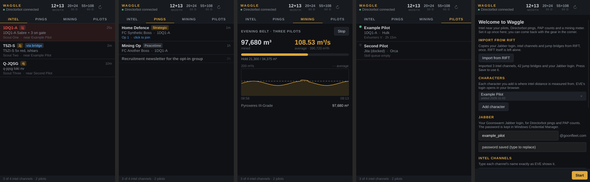

# Waggle

A lightweight EVE Online companion for Goonswarm pilots: a tray app on
Windows, with a bar widget for [Omarchy](https://omarchy.org) planned.



Waggle does four things and nothing else:

- **Intel**: watches your intel channels' chat logs and warns you when a
  hostile is reported near one of your characters, counting jump bridges.
- **Pings**: Directorbot fleet pings over Jabber, as desktop notifications.
- **PAP count**: your participation numbers, fetched from Directorbot.
- **Mining meter**: what you've actually mined, read from your game logs, and
  how full your hold is.

It also tells you when a skill finishes or a skill queue runs dry.

It's meant to replace RIFT for people who only want these features, without
the memory use and slowness. It sits in the system tray, and its first run
can import your Jabber login, intel channels and jump bridges straight from
RIFT.

The name comes from the waggle dance: the way a scout bee tells the hive where
something is.

## Install (Windows)

Download `waggle_<version>_x64-setup.exe` from the
[releases](https://github.com/dotbear/waggle/releases) (or, until there is
one, from the latest successful
[Windows build](https://github.com/dotbear/waggle/actions/workflows/windows.yml)'s
artifacts) and run it. It installs for your user only and needs no
administrator rights.

Windows will probably say **"Windows protected your PC"**, because Waggle is
not code-signed yet. Click **More info**, then **Run anyway**.

## First run

Waggle opens on its setup view:

1. **Import from RIFT**, if RIFT is installed: copies your Jabber login, intel
   channels and jump bridges, once.
2. **Add character**: EVE's login opens in your browser. Add every character
   you want intel distance measured from.
3. **Jabber**: your Goonswarm Jabber username and password. The password is
   kept in Windows Credential Manager, never in a file.
4. **Intel channels**: named exactly as EVE shows them.

Press **Start**. Closing the window hides it to the tray; the honeycomb icon
brings it back, and its menu has **Quit**. The gear in the corner reopens
setup.

Settings live in `%APPDATA%\Waggle`, everything else (state, logs) in
`%LOCALAPPDATA%\Waggle\data`.

Once a day Waggle asks GitHub whether a newer release is out, and says so
in a banner; nothing else is sent anywhere but EVE's servers and your
Jabber server.

## Thanks to RIFT

Waggle owes a great deal to [RIFT Intel Fusion Tool](https://riftforeve.online)
by Nohus. RIFT showed what a desktop intel tool for EVE should do, and much of
Waggle's feature set comes straight from using it every day: intel alerts by
jump distance, Directorbot pings, PAP counts, jump bridges, and its ESI login.
Waggle is a separate, much smaller program written from scratch. It doesn't
copy RIFT's code, and it identifies itself as Waggle, never as RIFT. If you
want maps, killmails, and everything else RIFT offers, use RIFT.

## Building

Rust 1.91 or newer.

```sh
cargo run -p waggle                        # the app
cargo test --workspace                     # everything
cargo run -p waggle --example screenshot   # render the window to a PNG, offscreen
```

Cross-compiling for Windows from Linux works with
[cargo-xwin](https://github.com/rust-cross/cargo-xwin):

```sh
cargo xwin build --release --target x86_64-pc-windows-msvc -p waggle
```

The installer is built on Windows with
[cargo-packager](https://github.com/crabnebula-dev/cargo-packager)
(`cargo packager --release -p waggle`), which is what CI does.
[docs/windows-notes.md](docs/windows-notes.md) lists what Windows taught us.

The workspace:

- `crates/waggle-core`: the engine (chat logs, intel, ESI, Directorbot over
  Jabber, mining, the store), shared with EVEmarchy, the Omarchy app it was
  split out of.
- `crates/waggle`: the app.
- `crates/waggle-data`: regenerates the bundled EVE data from CCP's static
  data export.

## Status

Early, and not yet used by anyone but its authors. [PLAN.md](PLAN.md) is the
plan and records where it stands.

## License

GPL-3.0-only.
